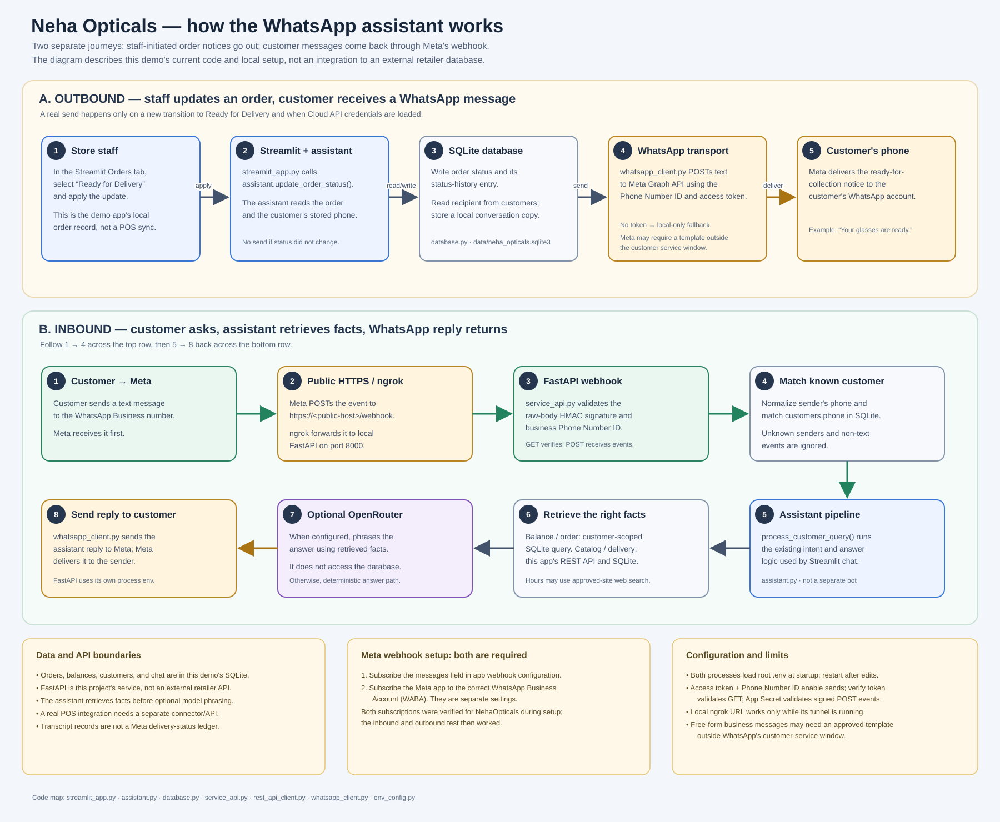

# Neha Opticals customer-care demo

A Streamlit prototype for a WhatsApp-style optical-store assistant. It demonstrates
order-ready notifications, customer-scoped order lookups, a grounded assistant,
direct SQL and separate REST API retrieval paths, and an operations dashboard.
WhatsApp stays simulated when no Cloud API access token is configured. With a token,
order-ready notices and replies to verified inbound webhook messages are sent through
the WhatsApp Business Cloud API.

## Run locally

Install/update dependencies:

```powershell
.\.venv\Scripts\Activate.ps1
pip install -r requirements.txt
```

Start the REST service in **terminal 1**:

```powershell
uvicorn service_api:app --host 127.0.0.1 --port 8000
```

Then start the Streamlit app in **terminal 2**:

```powershell
streamlit run streamlit_app.py
```

The service is available at `http://127.0.0.1:8000`; its interactive API
documentation is at `http://127.0.0.1:8000/docs`. To use another service address,
set `NEHA_API_BASE_URL` before starting Streamlit. Both processes must use the
same `OPTICALS_DB_PATH` if you override the default database location.

### Where to add API keys and tokens

Open the root-level [`.env`](.env) file in the project folder and paste values
after the `=` signs. Both Streamlit and FastAPI load this file automatically at
startup; restart both processes after changing it. The file is Git-ignored so
your credentials are not committed.

The keys are intentionally blank because credentials must be created or copied
from your Meta/AI provider accounts; this project cannot issue those credentials.
Use Meta's WhatsApp Business Cloud API setup to obtain the access token and
Phone Number ID. Choose your own strong webhook verify token, and copy the Meta
App Secret from the Meta app settings. `OPENROUTER_API_KEY` is optional and is
only needed for AI-phrased webhook replies. Do not send secrets in chat or commit
the completed `.env` file.

### WhatsApp Cloud API configuration

The same `.env` file supplies credentials to both local processes. If
`WHATSAPP_ACCESS_TOKEN` is blank, the order-ready path stays in local demo mode
and inbound webhook replies are not sent to Meta.

The Phone Number ID already provided for this project is prefilled in `.env`.
Fill in `WHATSAPP_ACCESS_TOKEN`, `WHATSAPP_VERIFY_TOKEN`, and `WHATSAPP_APP_SECRET`.
`OPENROUTER_API_KEY` is optional.

The Meta webhook callback URL is `https://<public-host>/webhook`; Meta requires a
public HTTPS endpoint. `GET /webhook` verifies `WHATSAPP_VERIFY_TOKEN`, and
`POST /webhook` verifies Meta's `X-Hub-Signature-256` using `WHATSAPP_APP_SECRET`.
Inbound text messages are handled only when the sender number matches a customer
in the local database; other senders and non-text messages are ignored. Real
messages are sent to the customer's stored phone number, so configure valid,
consented customer records before enabling the access token.

For temporary local testing, create an ngrok account and copy its authtoken from
the ngrok dashboard. Run `.\scripts\configure_ngrok.ps1` and paste the token into
its hidden prompt; it is saved in ngrok's local user configuration, not this
repository. Start FastAPI on port 8000, then run
`.\scripts\start_ngrok_webhook.ps1` in another PowerShell terminal. Copy ngrok's
current HTTPS Forwarding address and append `/webhook` to form the Meta Callback
URL. The URL changes when an ephemeral tunnel restarts. Stop the tunnel with
Ctrl+C when finished. It also exposes the demo's unauthenticated read-only API
routes; use only with demo data and keep it open only while testing.

The app creates `data/neha_opticals.sqlite3` and seeds it with fictitious customers,
orders, status history, FAQs, frame catalog entries, and sample query telemetry.
Set `OPTICALS_DB_PATH` to use another SQLite file. The database is intentionally
not checked into source control.

## Architecture and code map

**Service diagram:** [Open the full-size SVG](docs/service-flow.svg) or use the
preview below. For detailed sequence diagrams, a Python-file code map,
environment-variable ownership, and Meta Cloud API/webhook behavior and
limitations, see [docs/architecture.md](docs/architecture.md).



## Workspace interface

- The dark operations dashboard summarizes query volume, response time, estimated
  model cost, and SQL versus REST API usage.
- Conversations use avatar-free message cards and let staff inspect the customer’s
  order history alongside the conversation. **Chat history actions → Clear this
  chat** removes messages and their linked query/API telemetry after confirmation;
  customer and order records remain.
- Orders displays a live, editable SQLite table with each order's total and
  pending balance, recent status history, and an expandable database-table
  explorer. Applying a status change to **Ready for Delivery** sends a WhatsApp
  Cloud API message when configured, otherwise records a local simulated message,
  and opens that customer’s chat.

## Try the main flows

1. In **Conversations**, choose a demo customer and ask for an order update,
   order total or pending balance, frame options, current business information,
   warranty details, or a delivery quote. Example order IDs are `NC-2401`
   through `NC-2405`.
2. Compare the retrieval paths: order status and FAQ questions use parameterized
   SQL in the Streamlit app; catalog and delivery questions make HTTP GET calls
   to the separate FastAPI service, which queries SQLite and returns JSON. Current
   public business facts can use the model's approved-domain web-search tool.
3. In **Orders**, edit an order's total or balance, or update `NC-2402` to
   **Ready for Delivery**. Balances must be nonnegative and cannot exceed the
   order total. The app records the status transition and opens the customer's
   conversation. With Cloud API credentials it sends a real notification; without
   them it records a simulated notification. Re-saving the same status does not
   send a duplicate notification.
4. In **REST API playground**, make real HTTP requests to the read-only catalog,
   store, or delivery-quote endpoints and inspect status, latency, and JSON results.
5. In **Overview**, review answered-query counts for the last 2 hours, 2 days,
   1 week, and 1 month, response times, cost estimates, and recent query sources.
6. In **Settings**, add your OpenRouter key using the password field, test the
   provider connection, then enable **Use OpenRouter for response phrasing** and
   save. Select the model and token prices as needed. Defaults are a
   configurable GPT-4o mini benchmark of $0.15 / 1M input tokens and $0.60 / 1M
   output tokens; check OpenRouter's current pricing before production use.
7. Open **Conversations**, choose a demo customer, and send a question such as
   `What frame materials and prices do you have?` or `What is the status of NC-2401?`.
   The assistant retrieves verified SQL/REST context first, then uses the selected
   model to phrase its reply. The chat shows the model, response time, and cost.
8. To simulate a business-initiated WhatsApp message, choose **Naveed** in
   **Conversations**, expand **Start or send a simulated
   business message**, and record the draft. Then use the customer-message box
   below to simulate Naveed replying. Both directions stay in the local demo;
   neither sends a real WhatsApp message.

### Retrieval design

- **Direct SQL path:** order status, order total/balance, and FAQ intent handlers
  execute parameterized, customer-scoped SQL in the Streamlit app and pass only
  selected result fields into the response context. The assistant uses the saved
  order total and balance, never a web result or an inferred/guessed amount.
- **REST path:** the app's HTTP client calls the separate FastAPI process:
  - `GET /api/v1/catalog/frames`
  - `GET /api/v1/store`
  - `GET /api/v1/customers/{customer_id}/delivery-quote?order_id=NC-2401`
- The store endpoint remains available in the REST API playground for inspecting
  locally maintained contact data. The chatbot does not treat its old seeded
  hours as current; current public store information is searched on official sites.
- The service has fixed read-only endpoints; it does not accept or execute arbitrary
  SQL. The delivery endpoint scopes the order lookup to the supplied demo customer.
- Dashboard `tool_calls` rows record REST endpoint, success, and client-observed
  latency. `query_events.source` identifies database/REST retrieval and appends
  `+web_search` when the model actually invokes web search.
- Current opening hours and other public business facts are not seeded as fixed
  answers. When enabled, the model can choose to search the approved official
  websites; if web search is disabled or those sites do not provide an answer,
  the assistant says it cannot verify the fact rather than guessing. The provided
  Neha Opticals source is specifically its JP Nagar, Bengaluru store page, and the
  demo's default address is aligned to that branch. The demo retains the WhatsApp
  number supplied for this project as its contact number.

## OpenRouter phrasing

The deterministic responder works without a key. In **Settings**, you can enter
an OpenRouter key for the current Streamlit session and test the connection. The
key is held in server-side session memory only; it is not stored in SQLite and is
lost when that session ends. For persistent configuration across restarts, set
the key in the app process environment (never in source control):

```powershell
$env:OPENROUTER_API_KEY = "your-key"
streamlit run streamlit_app.py
```

The application retrieves the minimum order, FAQ, or REST API context first and
passes it to the configured model. Database access is never delegated to the
model. In **Settings**, **Allow web search for public business questions** offers
the model OpenRouter's `openrouter:web_search` server tool; the model chooses
whether a public-information query needs a search. Search results are restricted
to `nehaopticals.com`, `drsandhyaseyeclinic.setmore.com`, and
`drsandhyaseyeclinic.com`, with links requested for web-grounded claims. The
Neha Opticals source URL is
[the JP Nagar, Bengaluru store page](https://nehaopticals.com/stores/jp-nagar-bangalore/).
The demo's seeded address matches this branch; its WhatsApp contact number is
the number supplied for the project.

Order readiness, delivery quotes, catalog prices, and policy records remain
grounded in the database/API and cannot be overridden by web pages. The search
tool is intended for public information such as current hours, services, and
business details. OpenRouter currently documents this server tool as beta.
Token-based model costs are recorded as before; any separate search-tool charges
may not be included in the dashboard estimate. Actual provider token usage is
recorded when returned; otherwise cost is labeled estimated. Provider failures
are logged and surfaced while the deterministic response remains available.
Web search sends the customer’s question to the configured model/search service;
avoid putting private customer details in a public-information query.

## Data model

- `customers` → `orders`: one customer can have many orders. Orders store
  `total_amount_inr` and `balance_due_inr` as nonnegative integer rupees; the
  database constrains the pending balance not to exceed the total. Both values
  may be blank when the store has not confirmed pricing.
- `order_status_history`: append-only status transitions with actor/source and time.
- `messages`: inbound and outbound WhatsApp-shaped records, response metadata,
  token counts, and cost.
- `query_events`: one analytics row per inbound query, linked to the inbound
  message and customer.
- `tool_calls`: REST endpoint, success, source, and latency telemetry.
- `frame_catalog`, `store_info`, `faqs`: curated catalog, contact, and policy
  data for the REST service. Current hours are checked on approved websites
  rather than seeded as fixed business facts.
- `app_settings`: model name and editable token-rate assumptions (no API key).

The seeded order totals and balances are fictitious demo values. Existing SQLite
databases are migrated on startup; known seeded orders with both financial fields
unset receive the same sample values, while customized amounts are kept. Other
orders remain unpriced until staff enter verified values, and the assistant will
ask the customer to check with the store rather than presenting unknown amounts as zero.

SQLite is suitable for the local demo. A hosted deployment should use a managed
relational database, migrations, authenticated staff access, retention controls,
and durable transaction/idempotency handling for webhook events.

## Tests

```powershell
.\.venv\Scripts\python.exe -m unittest discover -s tests -v
```

## Before production

The REST API currently binds to loopback and is an unauthenticated local demo; do
not expose it publicly as-is. Before deployment, add API authentication/authorization
and HTTPS, add durable idempotency for webhook deliveries and status events, add
staff role-based access, use an approved database and secret manager, confirm
privacy/retention and consent requirements, and validate model/provider pricing,
data processing, and opt-out behavior with the business.
