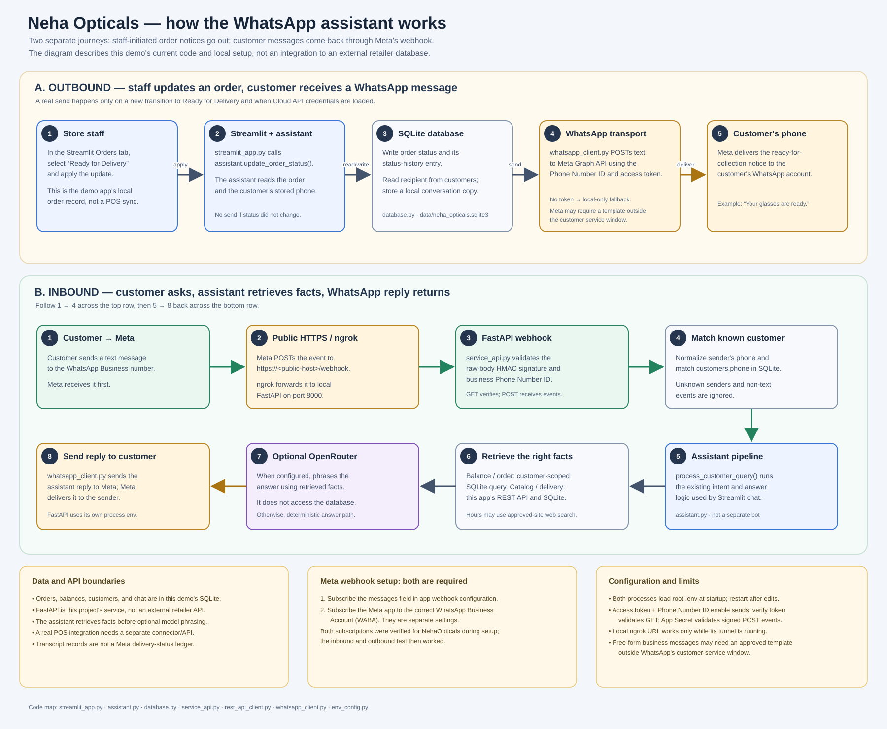
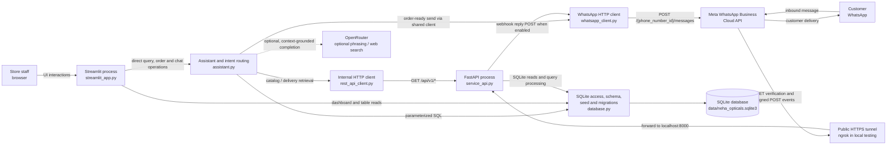
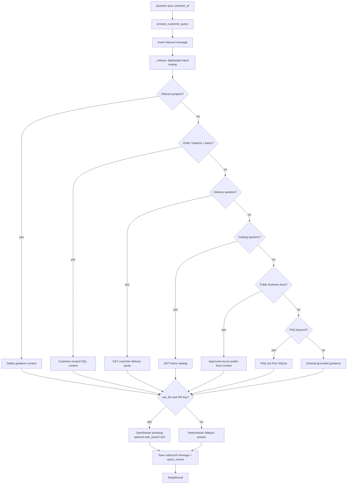
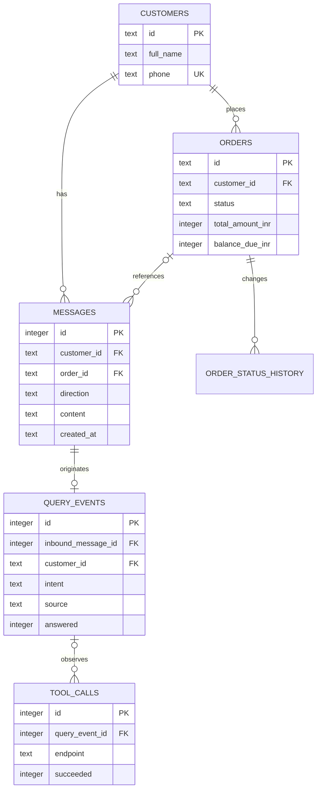

# Neha Opticals demo: architecture and code map

This note explains the current code paths in the Streamlit + FastAPI demo,
including the optional WhatsApp Business Cloud API transport. It is intended as
a code-orientation guide, not a production deployment approval.

## The flow in simple terms

Think of the system as a small optical-store application with a local database,
plus a WhatsApp connection:

- **Streamlit** is the staff website. Staff use it to inspect conversations and
  update orders.
- **SQLite** is this demo's own database. It stores its customer, order, balance,
  FAQ, and conversation records. There is no connection in this project to an
  external retailer/point-of-sale database.
- **FastAPI** is a separate Python process. It offers this project's catalog,
  store, and delivery-quote endpoints, and receives Meta's WhatsApp webhook.
- **Meta WhatsApp Cloud API** sends and receives real WhatsApp messages on behalf
  of the configured WhatsApp Business number.
- **ngrok** gives Meta a temporary public HTTPS route to the local FastAPI
  process during development. In a deployed system, a stable hosted HTTPS URL
  replaces ngrok.
- **The assistant** retrieves relevant facts using the existing intent and
  retrieval code. OpenRouter can optionally phrase the reply; it does not query
  SQLite directly.

### Example: an order becomes ready, then the customer asks about their balance

**Outbound: staff tells the customer the order is ready**

1. A staff member changes an order to **Ready for Delivery** in Streamlit's
   **Orders** tab and applies the change.
2. `streamlit_app.py` calls `assistant.update_order_status()`. The assistant
   reads the order and customer's stored phone, and writes the new status and
   status-history entry to this app's SQLite database.
3. On a new transition to that status, `whatsapp_client.py` sends the
   notification text to Meta's Graph API using the configured Phone Number ID
   and access token.
4. Meta sends the WhatsApp message to the customer's phone. The app also stores
   a transcript copy in SQLite. Clearing chat history does not undo a sent
   WhatsApp message.

**Inbound: customer asks a question and receives an answer**

1. The customer sends a WhatsApp text to the business number. Meta receives it.
2. Meta POSTs a signed event to the configured callback, such as
   `https://<ngrok-host>/webhook`. The public HTTPS tunnel forwards it to
   `service_api.py` running locally on port 8000.
3. FastAPI checks the request signature using `WHATSAPP_APP_SECRET`, checks the
   configured business Phone Number ID, then matches the sender's normalized
   phone number to an existing `customers.phone` record in SQLite.
4. The webhook passes the message to `assistant.process_customer_query()`, the
   same assistant pipeline used by the Streamlit Conversations tab. Unknown
   senders, non-text messages, and messages for a different business number are
   ignored; this demo does not automatically create customers.
5. The assistant selects relevant context. A balance or order-status question
   is answered from the customer's own order row in SQLite using
   customer-scoped SQL. Catalog or delivery questions can use this project's
   own FastAPI data endpoints and SQLite. Public business facts such as opening
   hours can use the optional OpenRouter web-search tool restricted to approved
   business domains.
6. If enabled and configured, OpenRouter receives the question and retrieved
   facts to phrase a natural-language answer. It is not given database access.
   If LLM phrasing is disabled or unavailable, the deterministic answer path is
   used.
7. The assistant saves the inbound and generated outbound transcript entries.
   The FastAPI webhook then sends the reply to Meta, which delivers it to the
   customer.

**Important distinction:** the sample story's “external application DB” and
“external application API” are not currently connected in this project. The
staff-facing status update and balance lookup use the demo's own SQLite data.
The REST API in this repository is this same application's FastAPI service, not
an external retailer API. A real POS/retailer integration would require a
separately configured API/database connector.

### WhatsApp setup has two separate subscriptions

For inbound messages to work, both of these must be true:

1. In the Meta app's WhatsApp webhook configuration, subscribe the `messages`
   webhook field and save the callback URL and verify token.
2. Subscribe the **Meta app itself** to the correct WhatsApp Business Account
   (WABA). Toggling the `messages` field alone does not attach the app to the
   WABA.

During this setup, the callback verification GET worked and the `messages` field
was enabled, but the WABA did not yet list the `NehaOpticals` app. Subscribing
the app to the WABA fixed inbound delivery. The WABA app subscription was
verified through Graph API on 2026-11-18; this workspace's two-way test then
worked. This is setup history, not a guarantee that a future token, callback,
or deployment remains valid.

## 1. System overview

The application has two local Python processes:

- **Streamlit** (`streamlit_app.py`) is the staff workspace and direct customer-chat
  demo. It reads and writes SQLite through `assistant.py` and `database.py`.
- **FastAPI** (`service_api.py`) provides the catalog/store/delivery data endpoints
  used by the assistant, and the Meta WhatsApp webhook endpoints.
- Both processes use the same SQLite file. The optional WhatsApp client is shared
  Python code, but each process has its own environment and must be configured
  separately.

### Visual service diagram



Open [service-flow.svg](service-flow.svg) directly to zoom into the complete
service and message flow. Detailed sequence diagrams and code notes follow below.



### Main request paths

1. **Staff workspace:** Browser → Streamlit → assistant/database, with optional
   Streamlit → FastAPI calls for catalog and delivery data.
2. **Order-ready notice:** Staff updates an order in this demo's SQLite through
   Streamlit → assistant records the status transition and invokes the WhatsApp
   client → Meta (if configured) → customer.
3. **Inbound WhatsApp:** Customer → Meta → public HTTPS tunnel (ngrok in local
   testing) → FastAPI webhook → customer lookup → existing assistant query
   pipeline and data retrieval → WhatsApp client → Meta → customer.
4. **Manual simulated message:** Streamlit → `record_simulated_outbound_message`
   → SQLite only. This UI action does not call Meta, even when Cloud API
   credentials are configured.

## 2. Detailed sequence diagrams

### A. Staff marks an order ready

```mermaid
sequenceDiagram
    autonumber
    actor Staff
    participant UI as Streamlit<br/>streamlit_app.py
    participant Assistant as assistant.py
    participant WA as whatsapp_client.py
    participant Meta as Meta Graph API
    participant DB as SQLite<br/>database.py

    Staff->>UI: Edit order status to Ready for Delivery
    Staff->>UI: Apply order updates
    UI->>Assistant: update_order_status(order_id, new_status, db_path)
    Assistant->>DB: Read order and customer phone
    Assistant->>DB: Update order status and append status history
    alt WHATSAPP_ACCESS_TOKEN is missing or empty
        Assistant->>WA: send_whatsapp_message(phone, text)
        WA-->>Assistant: False (no network call; demo fallback)
        Assistant->>DB: Insert outbound message in transcript
    else Cloud API is configured
        Assistant->>WA: send_whatsapp_message(phone, text)
        WA->>Meta: POST /v18.0/{phone_number_id}/messages<br/>Authorization header + JSON text payload
        Meta-->>WA: HTTP success or API error
        WA-->>Assistant: True or WhatsAppApiError
        Assistant->>DB: Insert outbound transcript record after successful send
    end
    Assistant-->>UI: Return notification text
    UI->>UI: Save summary and select customer's conversation
    UI-->>Staff: Render updated status and conversation
```

**Important current behavior:** outbound delivery is synchronous. The code calls
Meta from inside the SQLite transaction used by `update_order_status`. A failed
Cloud API request raises an error and rolls back that database transaction. A
successful external send followed by a later database commit failure cannot be
rolled back at Meta, so a retry could send a duplicate. There is no outbox or
Cloud API message-ID/delivery-status persistence yet.

The Orders UI’s notification wording and the Conversation view still use
“simulated” labels from the original demo. Those labels do not dynamically
reflect whether a real API request was made. The separate manual “Start or send a
simulated business message” control intentionally only records a local message.

### B. Meta sends an inbound text webhook

```mermaid
sequenceDiagram
    autonumber
    actor Customer
    participant Meta as Meta WhatsApp Business
    participant Tunnel as ngrok / public HTTPS URL
    participant API as FastAPI<br/>service_api.py
    participant DB as SQLite<br/>database.py
    participant Assistant as assistant.py
    participant REST as rest_api_client.py
    participant DataAPI as FastAPI data endpoints
    participant Model as OpenRouter (optional)
    participant WA as whatsapp_client.py

    Customer->>Meta: Send a text message to the business number
    Meta->>Tunnel: POST /webhook over public HTTPS
    Tunnel->>API: Forward to localhost:8000/webhook
    API->>API: HMAC-SHA256 raw body using WHATSAPP_APP_SECRET
    API->>API: Compare X-Hub-Signature-256; reject invalid signature
    API->>API: Check configured phone_number_id (when set)
    API->>DB: Load customer list and normalize stored phone numbers
    API->>API: Match messages[].from to a known customer
    alt Unknown sender, non-text, malformed or wrong phone-number ID
        API-->>Meta: 200 with ignored count (when payload structure is valid)
    else Known customer and text message
        API->>Assistant: process_customer_query(customer_id, text, settings, key)
        Assistant->>DB: Save inbound message
        Assistant->>Assistant: Route intent and retrieve minimum context
        opt Catalog or delivery intent
            Assistant->>REST: GET catalog or customer delivery quote
            REST->>DataAPI: GET /api/v1/catalog/frames or /delivery-quote
            DataAPI->>DB: Parameterized, customer-scoped SQL read
            DataAPI-->>REST: JSON result
            REST-->>Assistant: Validated result
        end
        opt LLM phrasing enabled and API key available
            Assistant->>Model: Context-grounded completion
            Model-->>Assistant: Reply text and usage metadata
        end
        Assistant->>DB: Save outbound reply and query telemetry
        Assistant-->>API: ReplyResult
        API->>WA: send_whatsapp_message(sender, reply)
        WA->>Meta: POST /v18.0/{phone_number_id}/messages
        Meta-->>WA: API response
        WA-->>API: Success or WhatsAppApiError
        API-->>Meta: 200 processed count or 502 send error
        Meta-->>Customer: Deliver reply
    end
```

The diagram shows the usual path; safety/validation failures return an HTTP error
instead of continuing. See [Webhook details](#5-meta-webhook-details) for exact
filters and current limitations.

### C. Assistant retrieval and response path



Routing order matters. Clinical guidance is checked first, financial/order
lookups are customer-scoped, delivery/catalog use the separate REST process, and
OpenRouter does not receive database access. It receives the question and
retrieved context only when LLM phrasing is enabled and a key is available. If
OpenRouter fails, the deterministic response is used and the provider error is
recorded.

## 3. Python file code map

| File | Responsibility | Useful entry points |
|---|---|---|
| [`streamlit_app.py`](../streamlit_app.py) | Staff-facing Streamlit app: Overview, Conversations, Orders, REST API playground, Settings; reads/writes local state and handles order-update navigation. | `render_overview`, `render_conversations`, `render_orders`, `render_api_playground`, `render_settings`, `get_openrouter_key` |
| [`assistant.py`](../assistant.py) | Query orchestration, customer/order operations, intent retrieval, deterministic answers, optional OpenRouter phrasing, transcript/telemetry writes, and order-ready transition. | `process_customer_query`, `answer_customer_query`, `_retrieve`, `_fallback_answer`, `_call_openrouter`, `update_order_status`, `get_customer_list`, `record_simulated_outbound_message` |
| [`service_api.py`](../service_api.py) | FastAPI app factory, health check, Meta webhook verification/receive routes, catalog/store/delivery JSON endpoints. | `create_app`, `GET /webhook`, `POST /webhook`, `GET /health`, `GET /api/v1/catalog/frames`, `GET /api/v1/store`, `GET /api/v1/customers/{customer_id}/delivery-quote` |
| [`database.py`](../database.py) | SQLite schema, connection/transaction helper, seed data, migrations, and settings. | `connect`, `initialize_database`, `get_settings`, `save_settings` |
| [`rest_api_client.py`](../rest_api_client.py) | Streamlit/assistant-side HTTP client for the separate FastAPI data endpoints, including timeout/response validation and endpoint errors. | `get_api_base_url`, `_get_json`, `get_frame_catalog`, `get_store_info`, `get_delivery_quote` |
| [`whatsapp_client.py`](../whatsapp_client.py) | Shared WhatsApp Cloud API text sender, phone normalization, Graph API version, transport error mapping, and no-token simulation fallback. | `send_whatsapp_message`, `normalize_phone_number`, `WhatsAppApiError` |
| [`.streamlit/config.toml`](../.streamlit/config.toml) | Streamlit presentation defaults: dark theme, colors, typography, and sidebar theme. | Loaded by Streamlit at startup |
| [`requirements.txt`](../requirements.txt) | Runtime dependency ranges for Streamlit, pandas, FastAPI, and Uvicorn. | Install with `pip install -r requirements.txt` |
| [`README.md`](../README.md) | Local run instructions, demo usage, and entry point to this architecture reference. | Repository onboarding |
| [`tests/test_app_logic.py`](../tests/test_app_logic.py) | Database-backed assistant and order behavior tests, including no-token and configured order-ready paths. | Run with unittest discovery |
| [`tests/test_rest_api.py`](../tests/test_rest_api.py) | Live local Uvicorn integration tests for REST and webhook routes; external Cloud API calls are mocked. | Run with unittest discovery |
| [`tests/test_whatsapp.py`](../tests/test_whatsapp.py) | Cloud API request construction and fallback/error configuration tests; no real Meta call. | Run with unittest discovery |

### Key cross-file call chains

- **Streamlit customer chat:** `streamlit_app.render_conversations` →
  `assistant.process_customer_query` → `_retrieve` → optional `rest_api_client`
  or direct SQL → optional `_call_openrouter` → `messages` and `query_events`.
- **Order-ready:** `streamlit_app.render_orders` → `assistant.update_order_status`
  → `whatsapp_client.send_whatsapp_message` → Meta Graph API; transcript is
  recorded in `messages`.
- **Inbound WhatsApp:** `service_api.receive_whatsapp_webhook` →
  `assistant.process_customer_query` → same query pipeline as chat → outbound
  `whatsapp_client.send_whatsapp_message`.
- **Catalog/delivery retrieval:** `assistant._retrieve` →
  `rest_api_client` → HTTP to `service_api` → SQL via `database.connect`.
- **Startup:** `service_api.app` captures `OPTICALS_DB_PATH`; the FastAPI lifespan
  calls `initialize_database`. `streamlit_app.py` initializes the database when
  its script starts. Configure both processes to the same path.

## 4. Configuration map

Environment variables are process-local. Setting a variable in one terminal does
not automatically configure the other process.

| Variable | Read by | Required for | Notes |
|---|---|---|---|
| `WHATSAPP_ACCESS_TOKEN` | `whatsapp_client.py` in each process | Real outbound text messages | If empty/unset, sender returns `False` without networking. Order-ready logic still records a local outbound transcript entry; inbound processing also records the reply locally but does not check this return value or deliver a real reply. Do not commit the value. |
| `WHATSAPP_PHONE_NUMBER_ID` | `whatsapp_client.py`; also `service_api.py` | Sending and inbound account matching | Used in the Graph API URL. For inbound events, a configured value must match `metadata.phone_number_id`. Missing ID with a token is an explicit send error. |
| `WHATSAPP_VERIFY_TOKEN` | `service_api.py` | Meta's one-time webhook subscription verification | App-chosen shared string, not the access token or app secret. Used by GET query parameter comparison. |
| `WHATSAPP_APP_SECRET` | `service_api.py` | Authenticating every POST webhook body | Meta app secret used for HMAC-SHA256 signature check; separate from `WHATSAPP_VERIFY_TOKEN`. |
| `OPENROUTER_API_KEY` | `streamlit_app.py`, `service_api.py` | Optional model phrasing for staff chat and inbound webhooks | Streamlit may instead use its session-only Settings key; inbound webhook processing reads the environment key. |
| `OPTICALS_DB_PATH` | `database.py`, `service_api.py` | Select a shared SQLite file | Set identically in both process environments. Defaults to `data/neha_opticals.sqlite3`. |
| `NEHA_API_BASE_URL` | `rest_api_client.py` | Streamlit-to-FastAPI data calls | Defaults to `http://127.0.0.1:8000`; set when service runs elsewhere. |

The Graph API version is a source constant (`GRAPH_API_VERSION = "v18.0"`) in
`whatsapp_client.py`, not an environment variable. The phone number ID is
configuration; it is not the recipient's phone number.

### Local `.env` setup

For local development, add the credentials to the root [`.env`](../.env) file.
The tracked [`.env.example`](../.env.example) lists the same variable names.
`env_config.py` loads the root `.env` before either app imports modules that read
environment configuration. Existing process environment variables take
precedence over values in the file. Restart both processes after editing it.

Use different deployment environment variables if deploying to separate hosts;
the `.env` file is a local-development convenience and should remain private.
Optional configuration such as `OPTICALS_DB_PATH` and `NEHA_API_BASE_URL` can
also be added to `.env` when needed. Leave them absent to use their defaults.
Start the app processes normally:

```powershell
.\.venv\Scripts\Activate.ps1
streamlit run streamlit_app.py
```

Start FastAPI in the other terminal with `uvicorn service_api:app --host
127.0.0.1 --port 8000`. Both processes load the same local file automatically.
Never commit or share real secret values; for hosted use, inject them through
the deployment platform's secret manager.

### Temporary public URL for local Meta testing

Meta cannot call `localhost`. Install ngrok and configure the ngrok account
authtoken in the ngrok CLI's local user configuration (not in the project `.env`).
The repository includes `.\scripts\configure_ngrok.ps1`, which prompts for the
token without echoing it and writes it through ngrok's CLI configuration command.
With the current FastAPI app running on port 8000, run
`.\scripts\start_ngrok_webhook.ps1`. It checks that the current API publishes
`/webhook` and then starts an HTTPS tunnel. Copy the `https://...` Forwarding URL
ngrok prints and append `/webhook`; use that full URL in Meta's Callback URL field.
Use the same value configured as `WHATSAPP_VERIFY_TOKEN` in the Meta Verify token
field. The temporary domain changes after the tunnel stops and restarts.

The tunnel exposes all routes on port 8000, including the demo's unauthenticated
read-only catalog/store/delivery endpoints. Use only with demo data, keep the
tunnel open only while testing, and stop it with Ctrl+C. This is a local testing
bridge, not a production hosting or security layer.

## 5. Meta webhook details

### Two subscription settings are required

Meta has two related but distinct settings; enabling one does not enable the
other:

1. **App webhook field:** in the Meta app's WhatsApp webhook configuration,
   configure the callback URL and verify token, then subscribe the `messages`
   field.
2. **WhatsApp Business Account (WABA):** subscribe the NehaOpticals Meta app to
   the WABA that owns the configured WhatsApp number.

During this setup, the callback verification GET succeeded and the `messages`
field showed **Subscribed**, but the WABA's `subscribed_apps` list did not
include the NehaOpticals app. That missing WABA-to-app subscription prevented
inbound events from reaching the webhook. The app was then subscribed to the
WABA and the Graph API response confirmed the NehaOpticals app in the list.
After that, a real two-way WhatsApp test succeeded. This is the verified setup
history for this workspace on 2026-11-18; a changed token, WABA, app, phone
number, callback URL, or tunnel can require checking both settings again.

### Verification handshake: `GET /webhook`

Meta sends query parameters including:

- `hub.mode=subscribe`
- `hub.verify_token=<configured shared verify token>`
- `hub.challenge=<challenge string>`

`service_api.py` requires the configured `WHATSAPP_VERIFY_TOKEN`, requires
`hub.mode` to equal `subscribe`, compares the token using
`hmac.compare_digest`, and returns the challenge as plain text. Missing server
configuration returns HTTP 503; mismatch or incomplete verification returns
HTTP 403.

### Message event: `POST /webhook`

Before reading message content, the route:

1. Requires `WHATSAPP_APP_SECRET`.
2. Reads the raw request bytes.
3. Calculates `sha256=` plus the HMAC-SHA256 digest of those exact bytes.
4. Constant-time compares it with `X-Hub-Signature-256`.
5. Rejects a missing/invalid signature with HTTP 403; missing app-secret
   configuration returns HTTP 503.

It then reads the Meta event shape
`entry[].changes[].value.metadata` and `value.messages[]`. The current handler:

- Accepts only messages with `type == "text"` and a non-empty `text.body`.
- If `WHATSAPP_PHONE_NUMBER_ID` is set, requires it to match
  `metadata.phone_number_id`.
- Normalizes digits from `messages[].from` and matches that value against a
  normalized `customers.phone` in SQLite.
- Ignores unknown numbers, non-text events, and messages for another configured
  business phone-number ID. It does not create new customers automatically.
- Passes matched message text through `process_customer_query`; it does not
  duplicate the intent handler or LLM logic in the webhook route.
- Sends the assistant reply as a text message back to the sender using the same
  configured business phone-number ID and access token.
- Returns a small processed/ignored count. This is a synchronous handler, not a
  queue/worker.

### Current Meta integration boundaries

- The implemented sender uses Graph API `v18.0` and a JSON text-message payload.
  It does not implement image/audio/document messages, templates, interactive
  buttons, read receipts, or delivery-status webhooks.
- A free-form text send may be rejected by Meta when the customer-service
  conversation window is closed. Business-initiated/out-of-window notifications
  generally need an approved message template; the current order-ready sender
  does not switch to a template. Confirm current WhatsApp policy, opt-in, template,
  and account requirements before sending to real customers.
- The code does not deduplicate Meta webhook message IDs. Meta retries, service
  restarts, or timeouts can therefore process the same inbound message more than
  once and send duplicate replies.
- If an inbound POST arrives while `WHATSAPP_ACCESS_TOKEN` is unset, the reply is
  generated and stored locally, but the sender returns `False` without contacting
  Meta. The current webhook route does not inspect that result and still counts
  the message as processed; configure the token in the FastAPI process to enable
  real replies.
- `process_customer_query` persists the inbound message and generated reply
  before `service_api.py` sends the reply over Cloud API. If Cloud API delivery
  fails, the generated reply is still present in the local transcript and the
  route returns HTTP 502.
- Meta delivery is not atomic with SQLite writes. There is no durable outbox,
  provider message-ID storage, or delivery reconciliation.
- Only send messages to correctly formatted, consented customer numbers. The
  seeded customer records are fictitious demo data. The test number supplied for
  setup is not automatically inserted into `customers`; an inbound message from
  it will be ignored unless a matching customer record is intentionally configured.
- The webhook must be reachable by Meta over public HTTPS. The default local
  Uvicorn command binds to loopback and cannot receive Meta callbacks from the
  public internet. Use a protected HTTPS deployment/ingress; do not expose this
  unauthenticated demo API directly.
- The signature check authenticates the payload but is not a replay/idempotency
  mechanism. Add durable deduplication and operational rate/body-size controls
  before production.

### Practical delivery checks

- **Outbound message visible in the local conversation but not WhatsApp:** the
  local transcript is not proof of provider delivery. Confirm the current
  Streamlit process has the current `WHATSAPP_ACCESS_TOKEN` and
  `WHATSAPP_PHONE_NUMBER_ID`; inspect a Cloud API error and the Meta message
  logs. A token can expire even if its environment variable is present.
- **Customer message appears in WhatsApp but gets no assistant reply:** check
  FastAPI health on port 8000, confirm the public HTTPS callback is still online
  and forwards to that port, then check Meta webhook delivery logs and FastAPI
  responses. For local testing, the ngrok process must remain running.
- **Meta webhook delivery returns success but no response is sent:** check
  sender matching in `customers.phone`, the configured Phone Number ID, the
  FastAPI process's environment, and Cloud API errors. The sender currently
  ignores messages from phone numbers that do not match a seeded/configured
  customer.
- **Messages show “Waiting for this message” in WhatsApp:** that is a WhatsApp
  synchronization/delivery state, not an assistant response status. Wait for
  WhatsApp to sync and check Meta's webhook logs before diagnosing the model.
- **A response is generated but Cloud API sending fails:** the incoming and
  generated reply may already be stored locally because assistant processing
  persists before the API send. Check the FastAPI error log and Meta response;
  the webhook returns HTTP 502 for a raised WhatsApp transport error.

## 6. Database and observable state

`database.py` owns schema creation and demo seeding. Principal relationships:



`messages` is the chat transcript for both local and Cloud API paths. It is not a
provider delivery ledger: the current implementation does not store Meta message
IDs or delivery statuses. `query_events` records assistant processing and cost
metadata; `tool_calls` tracks REST retrieval success and latency. Order status
history is separate and survives chat clearing.

## 7. Running checks

From the repository root, activate the project virtual environment and run:

```powershell
.\.venv\Scripts\python.exe -m unittest discover -s tests -v
```

The WhatsApp tests mock `urlopen` and the webhook reply sender; a passing suite
does not validate Meta credentials, phone-number registration, templates, public
HTTPS reachability, or real delivery.

## 8. Suggested production-hardening sequence

1. Validate business opt-in, customer number format, Meta account registration,
   app permissions, token lifecycle, and approved templates.
2. Move credentials into a secret manager and provide them independently to the
   Streamlit and FastAPI processes.
3. Add durable webhook event deduplication and an outbox/worker for outbound sends.
4. Persist provider message IDs and ingest delivery/read status callbacks.
5. Deploy the webhook behind HTTPS with request-size limits, monitoring, and
   alerting; restrict staff access and authenticate non-webhook API routes.
6. Reconcile transcript state when a provider send fails, and make UI status text
   distinguish local simulation from Cloud API submission/delivery.
7. Review privacy, retention, data processing, and access controls for customer
   messages before storing real conversations.
